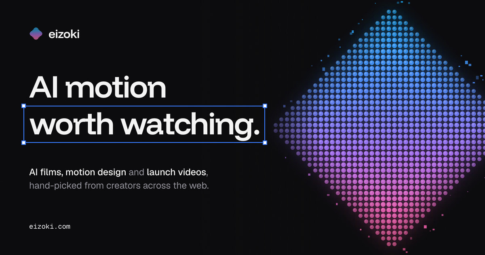
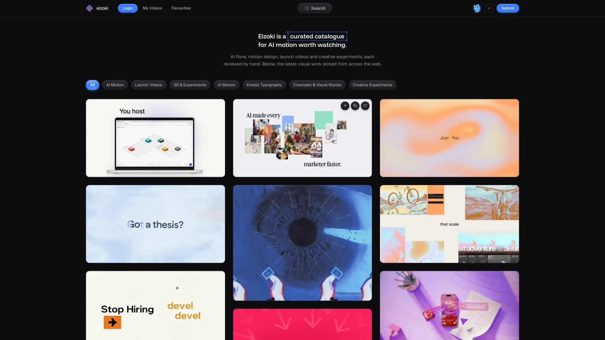
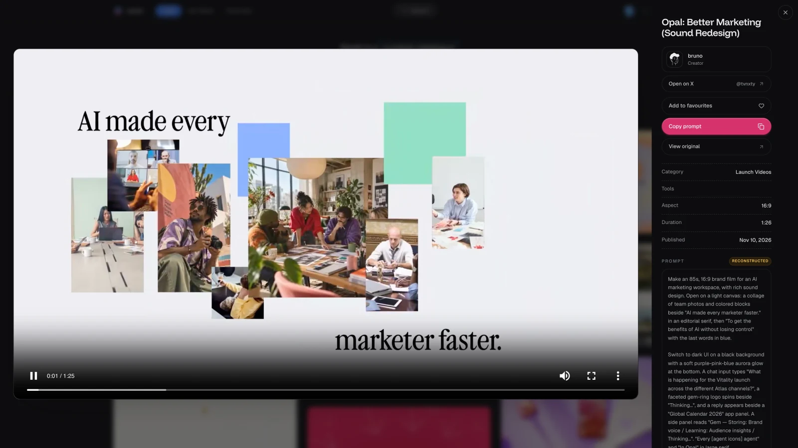
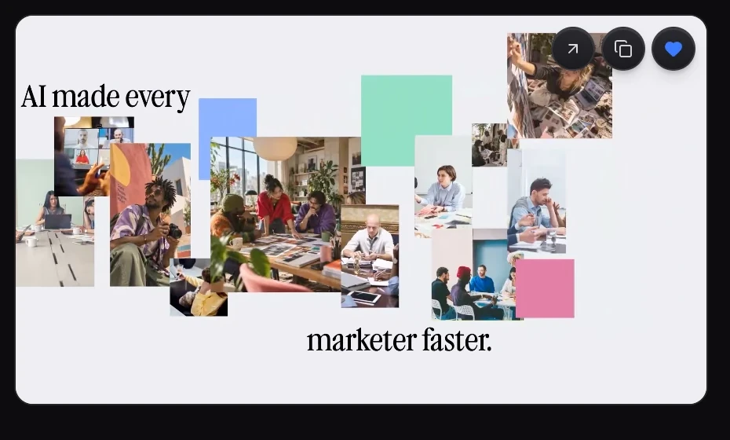

<p align="center">
  <a href="https://www.eizoki.xyz">
    
  </a>
</p>

<p align="center">
  A curated catalogue for AI motion worth watching.<br>
  Discover the film, meet the creator, take the prompt with you.
</p>

<h4 align="center">
  <a href="https://www.eizoki.xyz">Explore Eizoki</a> |
  <a href="#getting-started">Getting started</a> |
  <a href="#usage">Usage</a> |
  <a href="#how-it-works">How it works</a> |
  <a href="#contributing">Contributing</a>
</h4>

<p align="center">
  
  
  
  
  
  <a href="https://github.com/kaihere14/eizoki/issues"></a>
</p>

Eizoki brings AI films, launch videos, interface motion and creative experiments into one place. Browse a visual feed, open a film for its credits and workflow, and copy a shared prompt alongside a stable video reference. Every public submission passes through editorial review, and every entry credits its creator.

<p align="center">
  
</p>

## Highlights

| | |
|---|---|
| Discovery | A responsive masonry feed with seven creative categories, tags and search |
| Playback | Muted, looping previews that play in view and pause when you leave; a full player for a closer look |
| Creator credits | Creator names, profiles, tools and original-source links when supplied |
| Prompts | Original, reconstructed and unavailable labels; copy the prompt and a stable reference link |
| Favourites | A private, account-backed shelf of public videos you want to return to |
| Submissions | In-place uploads up to 500 MB, creator attribution and a review queue before community work goes public |
| My Videos | Track pending, approved and rejected submissions, preview your work and delete your own uploads |
| Appearance | Dark and light modes with blue or pink accents, saved between visits |
| Navigation | Search with ⌘K, Ctrl+K or `/`; the main navbar hides as you scroll down and returns as you scroll up |

## What you can see

<p align="center">
  
  <br>
  <sub><b>A closer look.</b> Watch the film, follow the creator and explore the prompt behind it.</sub>
</p>

<p align="center">
  
  <br>
  <sub><b>Keep the inspiration.</b> Save a favourite, copy a reference or jump to the original post from the feed.</sub>
</p>

<sub>Real UI captures from Eizoki. The catalogue changes as new work is published. The banner uses the site's Open Graph image.</sub>

## Getting started

Use [Bun](https://bun.sh), a PostgreSQL database and a [Clerk](https://clerk.com) development application. The repository pins Bun 1.3.14 in `package.json`.

```sh
git clone https://github.com/kaihere14/eizoki.git
cd eizoki
bun install
cp .env.example .env.local
```

Fill in `.env.local` with your Clerk development keys and `DATABASE_URL`. The auth routes are already set in the example. Then generate the client, apply the committed migrations and start the app:

```sh
bun run db:generate
bun run db:deploy
bun dev
```

Open [localhost:3000](http://localhost:3000). A new database starts with an empty catalogue; submit videos and approve them through an admin account to populate the public feed.

| Configuration | Purpose |
|---|---|
| `NEXT_PUBLIC_CLERK_PUBLISHABLE_KEY`, `CLERK_SECRET_KEY` | Authentication; use development keys locally |
| `DATABASE_URL` | PostgreSQL connection for users, videos, favourites and sponsorships |
| `R2_ACCOUNT_ID`, `R2_ACCESS_KEY_ID`, `R2_SECRET_ACCESS_KEY`, `R2_BUCKET_NAME`, `R2_PUBLIC_URL` | Video uploads and playback through Cloudflare R2 |
| `IMAGEKIT_PRIVATE_KEY` | Sponsor icons and deletion of videos stored before the move to R2 |
| `NEXT_PUBLIC_POSTHOG_PROJECT_TOKEN`, `NEXT_PUBLIC_POSTHOG_HOST` | Browser analytics configuration |

Configure Clerk for email-code authentication, Google and X, with custom sign-in and signup URLs pointing to `/sign-in`. R2 uploads need a bucket CORS policy that allows `PUT` from your site and exposes `ETag`. Grant admin access explicitly in the database; accounts are non-admin by default.

See the [developer reference](docs/DEVELOPMENT.md) for Clerk configuration, production setup, the R2 CORS policy, upload lifecycle, API contracts and database details. Do not commit `.env.local`.

## Usage

1. **Find a direction.** Browse All or filter by AI Motion, Launch Videos, 3D & Experiments, UI Motion, Kinetic Typography, Cinematic & Visual Stories, or Creative Experiments.
2. **Search the catalogue.** Click Search, press ⌘K / Ctrl+K, or press `/` outside a text field.
3. **Open a film.** Click a card for the player, credits, tools, prompt and original-source link when available. Close it to return to your place in the feed.
4. **Take a reference.** Copy prompt preserves the shared text and includes a stable video reference. When no prompt was shared, it copies adaptation instructions and the reference.
5. **Save something good.** Sign in to add favourites and return to them from your private shelf.
6. **Share your work.** Use Submit to upload a video and credit its creator. Community submissions enter review; My Videos shows their status.
7. **Make it yours.** Signed-in users can change appearance, accent colour and avatar from the account menu. The far-right GitHub icon opens this repository in a new tab.

## How it works

| Layer | Implementation |
|---|---|
| App | Next.js 16 App Router, React 19 and TypeScript |
| Interface | Tailwind CSS 4, Motion, Lucide and Hugeicons |
| Accounts | Clerk sessions behind a custom email-code and OAuth interface |
| Data | Prisma 7 with the PostgreSQL driver adapter |
| Media | Direct browser-to-R2 multipart uploads; the server validates and completes each upload |
| Feed | Cursor pagination, small poster images, a first-frame load queue and viewport-aware playback |
| Curation | Server-authorized reviews; only approved, published videos appear in public queries |
| Sharing | Open Graph and Twitter images, category landing pages, sitemap and structured metadata |
| Analytics | Vercel Analytics and configured PostHog browser analytics |

The browser uploads video parts directly to storage. The server checks ownership, metadata, file size, content type and file signature before saving a video record. Community submissions stay pending until reviewed; admin submissions publish immediately. Public queries also check publication time, keeping pending and future-dated work out of the feed.

```text
app/                 Pages, layouts, metadata, API routes and admin actions
components/          Feed, player, navbar, auth, submissions and account UI
lib/                 Validation, services, storage, search and SEO helpers
prisma/              Database schema and committed migrations
tests/               Unit tests, Playwright scenarios and media fixtures
docs/                Developer reference and README screenshots
promo-video/         Product launch video project and source assets
```

## Development

| Command | What it does |
|---|---|
| `bun dev` | Start the development server |
| `bun run build` | Generate Prisma's client and build for production |
| `bun start` | Serve the production build |
| `bun run lint` | Run ESLint |
| `bun run test:unit` | Run isolated unit tests |
| `bun run test:auth` | Run the Playwright end-to-end suite |
| `bun run db:migrate` | Create and apply a development migration |
| `bun run db:deploy` | Apply committed migrations |
| `bun run db:studio` | Browse the database with Prisma Studio |
| `bun run posters:backfill --dry-run` | Preview poster backfill for older uploads; requires ffmpeg |

For end-to-end tests, start the app with Clerk **development** keys and install Chromium:

```sh
bunx playwright install chromium
bun run test:auth
```

`PLAYWRIGHT_TEST_BASE_URL` selects a different local server. The authentication suite creates temporary Clerk test accounts and deletes them afterward; it refuses production keys. Real Google/X consent still requires a manual check with a provider account.

## Contributing

Issues and pull requests are welcome. Open an [issue](https://github.com/kaihere14/eizoki/issues) for a bug or idea, or fork the repository and create a focused branch. Before opening a pull request, run:

```sh
bun run lint
bun run test:unit
bun run build
```

For changes to authentication, playback or submissions, run the relevant Playwright scenarios too. Read [AGENTS.md](AGENTS.md) and the installed Next.js guides before changing framework code. More implementation details live in the [developer reference](docs/DEVELOPMENT.md).

## Built with

[Next.js](https://nextjs.org) · [React](https://react.dev) · [TypeScript](https://www.typescriptlang.org) · [Tailwind CSS](https://tailwindcss.com) · [Motion](https://motion.dev) · [Clerk](https://clerk.com) · [Prisma](https://www.prisma.io) · [PostgreSQL](https://www.postgresql.org) · [Cloudflare R2](https://developers.cloudflare.com/r2/) · [Bun](https://bun.sh)

## Star history

<a href="https://star-history.com/#kaihere14/eizoki&amp;Date">
  <picture>
    <source media="(prefers-color-scheme: dark)" srcset="https://api.star-history.com/svg?repos=kaihere14/eizoki&amp;type=Date&amp;theme=dark" />
    <source media="(prefers-color-scheme: light)" srcset="https://api.star-history.com/svg?repos=kaihere14/eizoki&amp;type=Date" />
    
  </picture>
</a>

## License

No license has been chosen yet. Featured work belongs to its respective creators; see each video's attribution and original source.

<p align="center">
  <sub>Made by <a href="https://x.com/ArmanKiyotaka">@ArmanKiyotaka</a></sub>
</p>
